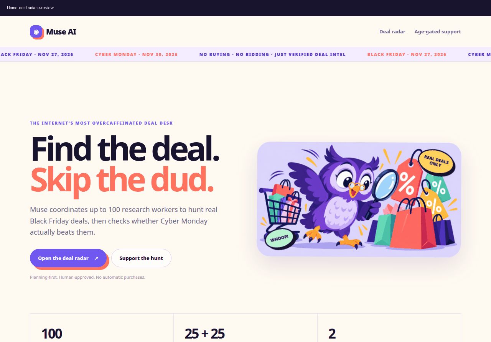
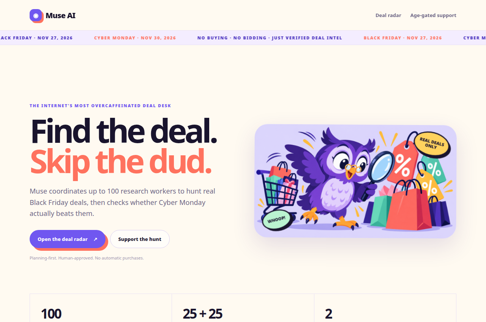
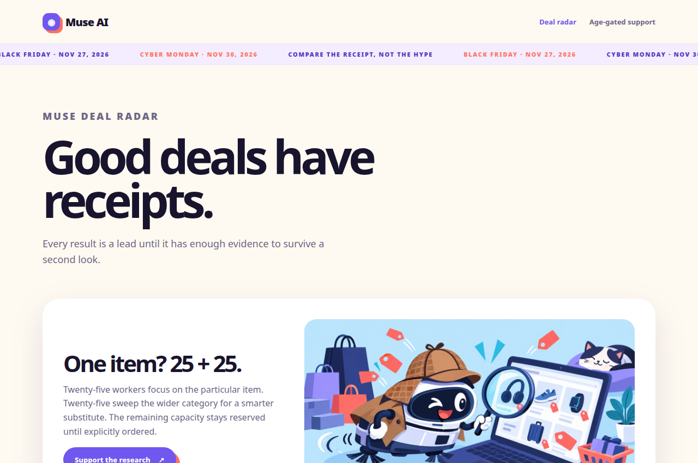
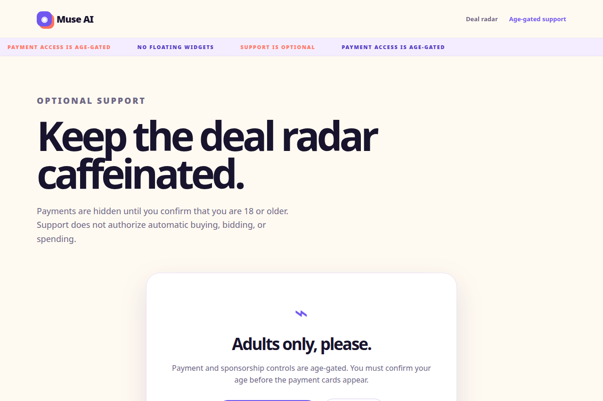
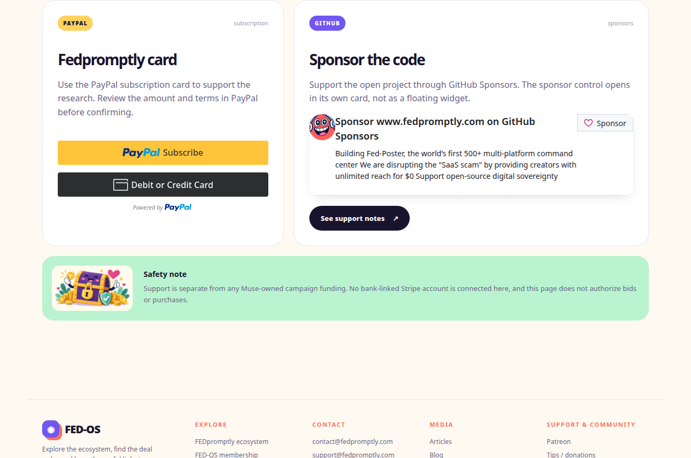

# Muse AI Black Monday

Plan, verify, and compare Black Friday and Cyber Monday deal research without dispatching workers or making purchases automatically.

> **Status:** working static front end and Python planning toolkit. No live demo URL, CI workflow, package manager, or payment integration is configured in this repository.

## Why this exists

Seasonal shopping research is noisy. A product can look discounted because its price was raised beforehand, be unavailable at checkout, hide the real cost behind shipping or membership terms, or quietly change model and condition between two listings. Searching manually across many merchants is repetitive, and a large worker pool is hard to control if assignments are not visible first.

Muse AI Black Monday makes that workflow explicit. It creates an auditable worker plan, keeps dispatch off by default, validates the evidence attached to a candidate deal, and compares a Cyber Monday result against a like-for-like Black Friday baseline. The project is intentionally conservative: recommendations are review material, not purchase authorization.

## See it work

There is no hosted demo configured yet. The fastest real demo is the local static site:

```bash
python3 -m http.server 8000
```

Then open [http://localhost:8000/index.html](http://localhost:8000/index.html). The page is the repository's actual entry point and includes the deal-radar flow, seasonal ticker, verification criteria, age-gated support page, and public FED-OS footer.

The animated demo below was captured from those local HTML pages. It shows the real home page, worker model, deal radar, age gate, and post-confirmation support state—not a mockup.



## Screenshots









## Quick start

### 1. Run the static site

From the repository root:

```bash
python3 -m http.server 8000
```

Open `http://localhost:8000/index.html`. No npm install or build step is required. The same root can be published as a static site through GitHub Pages or Cloudflare Pages, but neither deployment is enabled or configured here.

### 2. Generate a planning-only worker allocation

A broad category search assigns the requested number of workers to that category:

```bash
python3 scripts/main.py plan \
  --mode broad \
  --category electronics \
  --workers 50
```

For one named item, the default 25/25 split sends 25 planned assignments to the item and 25 to the wider category sweep:

```bash
python3 scripts/main.py plan \
  --mode item \
  --item "noise-cancelling headphones" \
  --category electronics \
  --workers 50
```

Both commands print JSON and explicitly report `"dispatch": false`. The scripts create plans; they do not send workers anywhere.

### 3. Verify and compare real records

Verification expects a JSON record containing a live URL, current price, merchant, UTC timestamp, stock confirmation, price evidence, and a discount percentage. Example command:

```bash
python3 scripts/main.py verify --deal-json path/to/deal.json
```

Compare a Black Friday baseline with a Cyber Monday record:

```bash
python3 scripts/main.py compare \
  --baseline path/to/black_friday.json \
  --cyber path/to/cyber_monday.json
```

The comparison is like-for-like only when the product identity, model, variant, condition, and currency match.

### 4. Run the tests

```bash
python3 -m unittest discover -s tests -v
```

The current test suite covers the 25/25 item allocation, the 100-worker cap, discount calculation, evidence-backed verification, Cyber Monday comparison, and funding approval rejection.

## What the project actually contains

The repository has two working entry points:

- `index.html` is the static-site entry point. `deals.html`, `donate.html`, `discord.html`, `invite.html`, `thanks.html`, and `private-communities.html` are linked pages. The attached FedPromptly invite-card design is available at `invite.html`.
- `scripts/main.py` is the command-line entry point for planning, verification, and comparison.

The Python side uses the standard library only. Its main modules are:

- `worker_split.py` — creates broad or item-focused assignment plans, capped at 100 workers;
- `deal_search.py` — normalizes candidates, calculates percentage discounts, and ranks records;
- `verify_deal.py` — checks the evidence fields required for a confirmed deal;
- `cyber_monday_check.py` — compares a Cyber Monday candidate with a Black Friday baseline;
- `stripe_funding.py` — validates a proposed funding plan without making Stripe API calls;
- `main.py` — exposes the CLI commands.

The static site adds animated presentation, a symbolic favicon, local promotional artwork, the GitHub Sponsors card, the age-gated payment section, and a public FED-OS footer. Payment controls remain behind the age gate; the repository does not automatically bid, buy, or connect to a bank-linked Stripe account.

## Project dates and defaults

- Black Friday: November 27, 2026
- Cyber Monday: November 30, 2026
- Maximum planned workers: 100
- Default particular-item split: 25 item-focused assignments plus 25 category-sweep assignments
- Stripe: disabled by default; configured monetary caps are zero
- Purchase and bid approval: human approval required

## Repository map

```text
MuseAi-Black-Monday/
├── index.html
├── deals.html
├── donate.html
├── discord.html
├── thanks.html
├── private-communities.html
├── invite.html
├── assets/
│   ├── favicon.svg
│   ├── site.css
│   ├── site.js
│   ├── muse-deal-hunt.png
│   ├── cyber-monday-scan.png
│   ├── funding-lock.png
│   └── demo/
│       ├── demo.gif
│       ├── demo-01-home.png
│       ├── demo-03-deals.png
│       ├── demo-04-age-gate.png
│       └── demo-05-payment-controls.png
├── config.json
├── docs/
├── results/
├── scripts/
└── tests/
```

## Deployment reality

The HTML is static and can be served from the repository root by GitHub Pages or Cloudflare Pages. There is currently no `wrangler.toml`, Pages workflow, GitHub Actions workflow, package file, or live deployment URL in the repository, so this README does not claim that a public deployment exists. If you publish it, use the repository root as the output directory and keep the relative links intact.

## Safety boundaries

This is a research and planning scaffold. Workers are not dispatched unless a separate system explicitly orders them. A candidate is not a confirmed deal without reproducible evidence. Funding validation is offline only. Never treat a worker plan, deal score, or donation as permission to place a bid or purchase an item.
